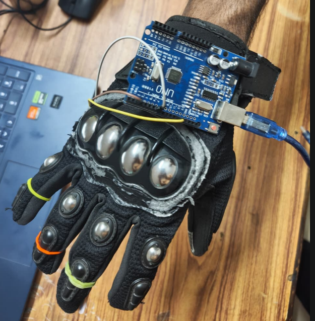
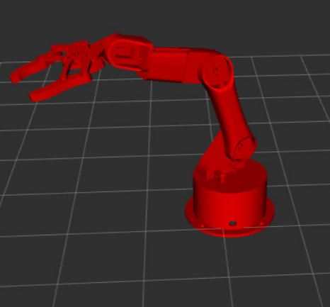
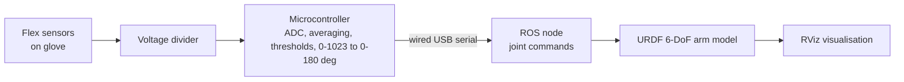

# 🧤 Gesture-Controlled Robotic Arm — Flex-Sensor Glove and ROS Simulation

**B.Tech Robotics & Automation · Mini Project · Adi Shankara Institute of Engineering & Technology, Kalady (APJ Abdul Kalam Technological University)**

A wearable **flex-sensor glove** that reads finger bending through an **Arduino-based microcontroller** and maps it to the joint angles of a **6-DoF robotic arm** modelled in **URDF** and visualised in **ROS / RViz**.


<p align="center">
  
  
</p>
<p align="center"><em>The sensor glove (left) and the robotic arm model in RViz (right).</em></p>

## 🔎 Overview
Conventional ways of controlling robots, such as joysticks and preprogrammed commands, often need technical know-how and do not feel natural.
This project uses **natural hand gestures** instead. A glove carrying flex sensors measures how far each finger is bent; a microcontroller converts the
readings into joint angles and sends them over a wired serial (USB) connection to a computer running ROS, where the arm model moves in real time in RViz.

## 🎯 Objectives
- Build a wearable glove with flex sensors that detects finger bending.
- Convert the sensor signals to control values using a microcontroller (filtering and mapping).
- Model a 6-DoF robotic arm in URDF and simulate it in ROS.
- Replace joystick or keyboard control with a more natural gesture interface.
- Identify applications in assistive technology, automation, medicine and remote handling.

## 🧩 System Architecture


## ⚙️ Working Principle
**Stage 1: sensor data acquisition.** Flex sensors on the fingers change resistance as they bend. A voltage-divider circuit turns the resistance change into a voltage, which the microcontroller reads through its analog pins and converts with its built-in ADC. Calibration adjusts the readings for different hand sizes and bending ranges.

**Stage 2: signal processing and mapping.** Averaging and thresholding reduce noise. The sensor range (for example 0–1023) is mapped to a joint range (for example 0°–180°) so motion is proportional. Each finger is assigned to a joint or function, such as base rotation, arm lifting or gripper operation. The mapped data is sent to the computer over wired serial.

**Stage 3: ROS simulation and control.** A ROS node receives the serial data and interprets it as joint commands. The arm, described in URDF, updates its joint states, and RViz shows the motion.

## 🦾 Robot Model (URDF)
The 6-DoF arm is described in [`ros/urdf/robot.urdf`](ros/urdf/robot.urdf), a xacro-based URDF named `open_manipulator`, with joint limits and a two-finger gripper. It is loaded in RViz for visualisation.

The links load STL meshes (`plate.stl`, `link1.stl` to `link5.stl`, `gripper_left_palm.stl`, `gripper_right_palm.stl`) from the package `my_robot_description/meshes`. The mesh files are not included in this repository.

## 🔧 Hardware & Software
| Item | Detail |
|---|---|
| Input device | Glove with flex sensors on the fingers |
| Signal conditioning | Voltage divider circuit |
| Microcontroller | Arduino-based board (analog inputs, built-in ADC) |
| Communication | Wired USB serial to the computer |
| Framework | ROS |
| Robot description | URDF |
| Visualisation | RViz |

## 📁 Repository Structure
```
Gesture-Controlled-Robotic-Arm/
├── docs/     # Mini project report (Word)
├── images/   # Glove photo and RViz arm model
├── ros/
│   ├── urdf/robot.urdf        # arm description (xacro URDF)
│   └── launch/display.launch  # launch file (from the report appendix)
└── README.md
```

## ▶️ How to View the Arm Model
The launch file is the one listed in the report appendix, and the URDF is the xacro file used for the arm model. The launch file is written in the ROS 1 launch format and starts `joint_state_publisher_gui`, `robot_state_publisher` and RViz, so the joints can be moved with sliders.
1. Create a ROS package named `my_robot_description` with `urdf/` , `launch/` and `meshes/` folders.
2. Copy `robot.urdf` into `urdf/` and `display.launch` into `launch/`, and put the STL mesh files listed above into `meshes/` (the meshes are not included in this repository).
3. Build the workspace, source it, and run `roslaunch my_robot_description display.launch`.

The glove firmware and the serial-reading ROS node are not included in this repository.

## 📊 Results & Observations
- The system detects finger movements through the sensor glove and converts them into control signals.
- The signals are sent to ROS, where the simulated arm follows the gestures with smooth, proportional movement and minimal delay, as described in the project report.
- The report describes the performance qualitatively; it gives no measured latency or accuracy figures.

<p align="center"></p>

## 🏭 Applications
- **Industrial:** operating tools from a safe distance in hazardous or high-temperature settings.
- **Medical:** assisting precise tasks, handling equipment with minimal contact, and rehabilitation.
- **Research and education:** studying sensor integration, gesture recognition and robot motion control.
- **Virtual reality and gaming:** gesture-based interaction.
- **Remote and hazardous environments:** disaster response, space and underwater manipulation.

## 🚀 Future Scope
- Wireless communication in place of the wired serial link
- Real-time implementation on a physical robotic arm
- Inverse kinematics and motion planning (for example with MoveIt)
- Computer vision and machine learning for richer gesture recognition

## 📚 References (from the report)
Tiwari et al. (2018), Tikam et al. (2019), Afzal et al. (2017), Herbaz et al. (2021), Yu et al. (2023), Kouao (2021, YouTube tutorial), Megalingam et al. (2018), Jhang et al. (2017), Korsoveczki et al. (2018). The full list is in the [report](docs/Gesture_Controlled_Robotic_Arm_Mini_Project_Report.docx).

